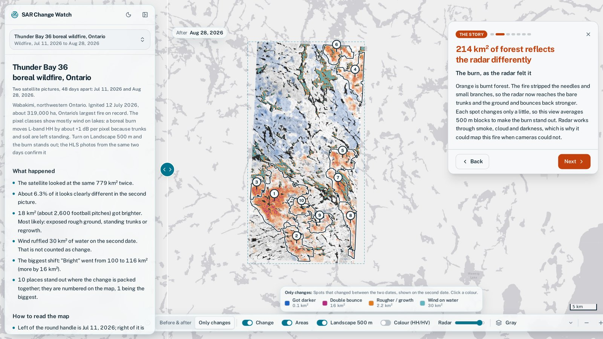
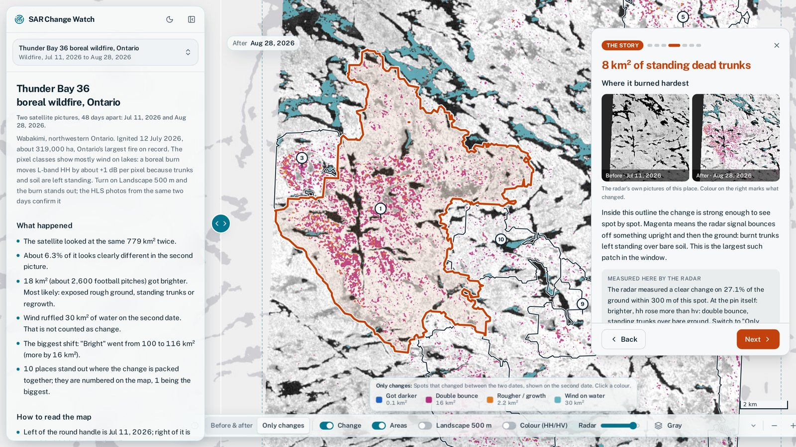
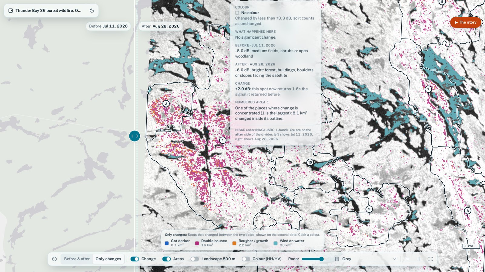

# SAR Change Watch: NISAR change detection (map)

**See what a disaster changed on the ground, through smoke, cloud and darkness.** A full-screen map
that compares two NISAR L-band radar passes and tells the story of a flood, fire or landslide in
plain language: what changed, where, and how much.

Built for the NASA Space Apps Challenge 2026, "Dancing with the SARs". I wrote almost all of the
code: this map, and the processing pipeline and API in
[sars-backend](https://github.com/BahirYasrebSeemab/sars-backend). Team repositories:
[yusof-shkn/sars-frontend](https://github.com/yusof-shkn/sars-frontend) and
[yusof-shkn/sars-backend](https://github.com/yusof-shkn/sars-backend).

| Follow the story to the places that changed most | Point at any spot for a plain-language reading |
|---|---|
|  |  |

**Stack:** React 19 · TypeScript · Vite · Tailwind CSS 4 · Leaflet · Base UI · Playwright checks.
Backend: Python · FastAPI · NASA Earthdata (NISAR GCOV) · uv · pytest.

## Run
Start the backend first (see its README), then:

    bun install
    bun run start            # http://localhost:5173; API at VITE_API_URL, default http://localhost:8000

With `VITE_API_URL=` (empty) in `.env`, the page asks its own address for `/api` and `/files` and
the Vite dev server forwards them to the backend (`BACKEND_URL`, default http://127.0.0.1:8000).
Page and data then share one address and one port, so others on the network can open
`http://<this machine's IP>:5173` while the backend stays on localhost.

## What is on the page
- Left sidebar: a searchable event list, the measured change per class, the numbered areas
  (searchable by number or by darker / growth / double bounce), the change histogram, how to read
  the radar, and the data provenance (granules, release maturity, orbit data).
- The side panel speaks plain language first ("What happened", "How to read the map", the
  numbered places); the radar terms, thresholds, histogram and granule table sit in a
  "Technical details" section that opens on click.
- A "?" button on the toolbar opens a five-step guide; it also opens once on a first visit.
- Map colours, two views (switch on the toolbar, "Land" / "Changes" on a phone):
  - **Before & after** (default): both dates painted in the same four classes (water, smooth ground,
    fields & shrubs, bright), so dragging the divider shows what grew and what shrank.
  - **Only changes**: only what changed, on the after date (darker, double bounce, rougher, wind on water).
- Colour key above the toolbar: every colour with its km² (before -> after in the Ground view);
  a click explains what it stands for, what it can mean for this kind of event and its usual causes.
- Rest the mouse anywhere for a plain-language reading of that spot: its colour, the ground on
  each date in words, how much the signal changed and the numbered area it belongs to.
- Map: before date left of the divider, after date right of it. Switches for the change classes,
  the numbered areas, the 500 m landscape layer and the HH/HV colour view; radar opacity; gray,
  satellite, street and dated NASA photo basemaps. Click anywhere to read that pixel.

## Checks
Run against the dev servers (backend on 8000, this app on 5173 or the port Vite prints):

    uv run --with playwright python -I e2e/smoke.py     # every map action, phone layout
    uv run --with playwright python -I e2e/areas.py     # numbered areas and the swipe, as shown
    uv run --with playwright python -I e2e/offline.py   # NASA photos with NASA's servers blocked

Stack: React 19, Vite, Tailwind CSS 4, Leaflet (react-leaflet), Base UI.
